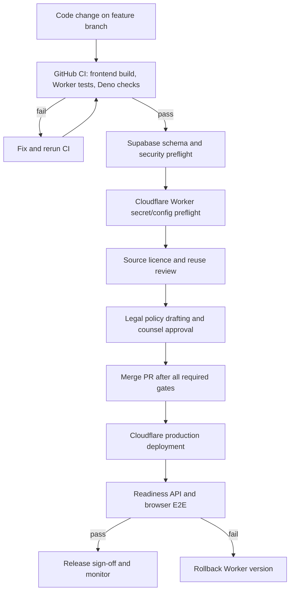

# MONK Automated Operations and Release Workflow

Updated: 2026-11-22

## Purpose

This document defines one repeatable workflow for moving MONK from the current implementation branch to a verified production release. It distinguishes actions the repository and connected services can execute from external approvals and credentials that cannot be fabricated.

## Workflow graph

## Machine-verifiable readiness

After the Worker branch is deployed, request:

`GET https://monk.monster/api/system/readiness`

The endpoint returns safe aggregate values only:
- Whether the Worker has `GOOGLE_MAPS_API_KEY` configured (boolean only).
- Count of published institution records.
- Count of source records with approved terms and imports enabled.
- Count of published and effective policy documents.
- A blocker list and timestamp.

It never returns secret values, institution PII, raw source data, or policy text. The directory import token is held by Supabase Edge Functions and cannot be introspected by the public Worker; verify it in Supabase Edge Function secrets.

## Execution stages

### Stage 1 — Repository CI (automated)

Every push to the feature branch and every PR targeting main runs:
1. Node dependency install.
2. Frontend TypeScript/Vite production build.
3. Cloudflare Worker syntax check.
4. Worker route regression suite.
5. Deno type checks for policy and directory Edge Functions.

A failed stage blocks the release branch from being marked ready.

### Stage 2 — Supabase configuration (partially automated)

Required server-side Edge Function secret:
- `DIRECTORY_IMPORT_TOKEN`: high-entropy random value stored only in Supabase Edge Function secrets. The same value is used by the trusted import runner; never commit it or expose it in browser code.

The import function checks both this token and the source registry's `terms_review_status='approved'` and `import_enabled=true`. Newly imported institutions and programmes remain unverified/unpublished; imported approvals remain source-reported until reviewed.

The current Supabase connector can inspect project schema and deploy Edge Functions but does not expose an Edge Function secrets-management action in this session. Therefore this secret must be configured in the Supabase Dashboard (Project Settings / Edge Functions / Secrets) or by an authorized Supabase CLI session. Do not paste the token into GitHub, this document, or chat.

### Stage 3 — Google Places (external billing and credentials)

Required:
1. Google Cloud project controlled by MONK owner.
2. Places API (New) enabled.
3. Billing account attached.
4. API key restricted to Places API (New), with allowed quota and budget alerts.
5. `GOOGLE_MAPS_API_KEY` added as a Cloudflare Worker secret for Worker `monk`.

The Worker reads this key only server-side. It must not be placed in Vite variables, source files, GitHub Actions logs, or public runtime config. A missing key intentionally returns HTTP 503. No credential or billing resource is created automatically by this repository workflow.

### Stage 4 — Official institution sources (approval before ingestion)

For every source registry row:
1. Confirm the actual source URL and responsible authority.
2. Record licence/terms and whether commercial reuse, extraction, storage, and republication are permitted.
3. Record required attribution, update cadence, and any permission letter.
4. Set the source review status to approved and enable import only after the evidence is recorded.
5. Import in bounded batches with stable source record IDs.
6. Run duplicate/source-identity review.
7. Human reviewer checks identity, location, source evidence and programme/approval year.
8. Publish only the fields that have passed verification.

Never convert an unverified record into a verified listing merely to populate the directory. AISHE content is not imported until the required Ministry permission is confirmed.

### Stage 5 — Legal policy documents (counsel approval required)

Prepare drafts for:
- Platform Terms of Service.
- Privacy Notice describing actual data collection, location, analytics, communications and retention.
- Education/student/minor-data schedule.
- Business/organization schedule.
- Data Processing Agreement and vendor/subprocessor disclosures where applicable.
- Optional payments, location and marketplace notices before those modules are enabled.

A qualified India privacy/technology counsel must review the drafts against MONK's real data flows and applicable Indian law, including DPDP requirements and student/minor data handling. Only after approval should immutable content, version, effective date, jurisdiction and SHA-256 hash be inserted and published. The onboarding gate must remain closed for missing required policies.

### Stage 6 — Production deployment and rollback

Only after all applicable gates pass:
1. Merge PR #20 to main.
2. Allow the main-branch Cloudflare deployment workflow to publish Worker and static assets.
3. Verify deployment version and production custom domain.
4. Run `/api/system/readiness`.
5. Run directory, Places, Terms/Privacy, signup, email verification, role-based access and two-tenant isolation E2E tests.
6. Confirm Cloudflare rollback target before announcing release.
7. Monitor Worker logs, Supabase Edge Function logs, error rates, provider quota and billing.

Do not mark the release complete if the readiness endpoint returns `blocked`, E2E tests are missing, or rollback cannot be verified.

## Current known external gates

- `GOOGLE_MAPS_API_KEY` absent from Worker `monk`; Google billing/API restriction/quota setup unverified.
- `DIRECTORY_IMPORT_TOKEN` must be configured in Supabase Edge Function secrets; connector has no secrets-write action.
- All 19 source registry entries are import-disabled pending source-specific terms/licence review.
- No legally reviewed/effective policy documents are published.
- No published institution data exists yet.
- Auth leaked-password protection is disabled and must be enabled in Supabase Auth security settings.
- Full per-RPC authorization review, two-tenant adversarial tests and browser E2E remain release gates.

## Safe operational rules

- Never invent secrets, billing accounts, source permissions, legal approvals, real institutions, or test results.
- Keep payments, location and marketplace feature flags disabled until their compliance controls are implemented and approved.
- Preserve fail-closed behavior for missing provider keys, unapproved sources and unpublished policies.
- Every release report must include commit SHA, CI run, deployed Worker version, readiness response, E2E result and rollback target.
